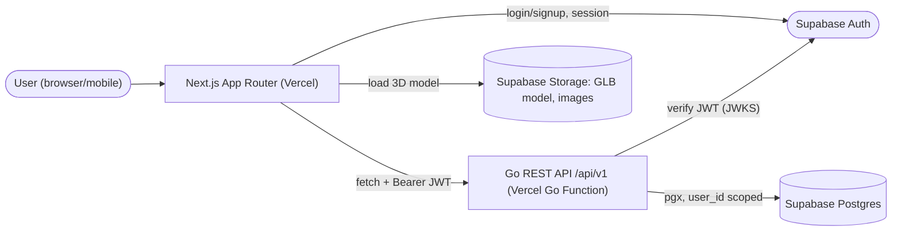
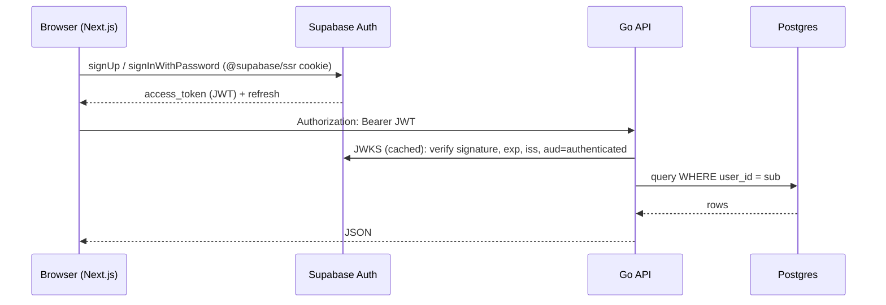
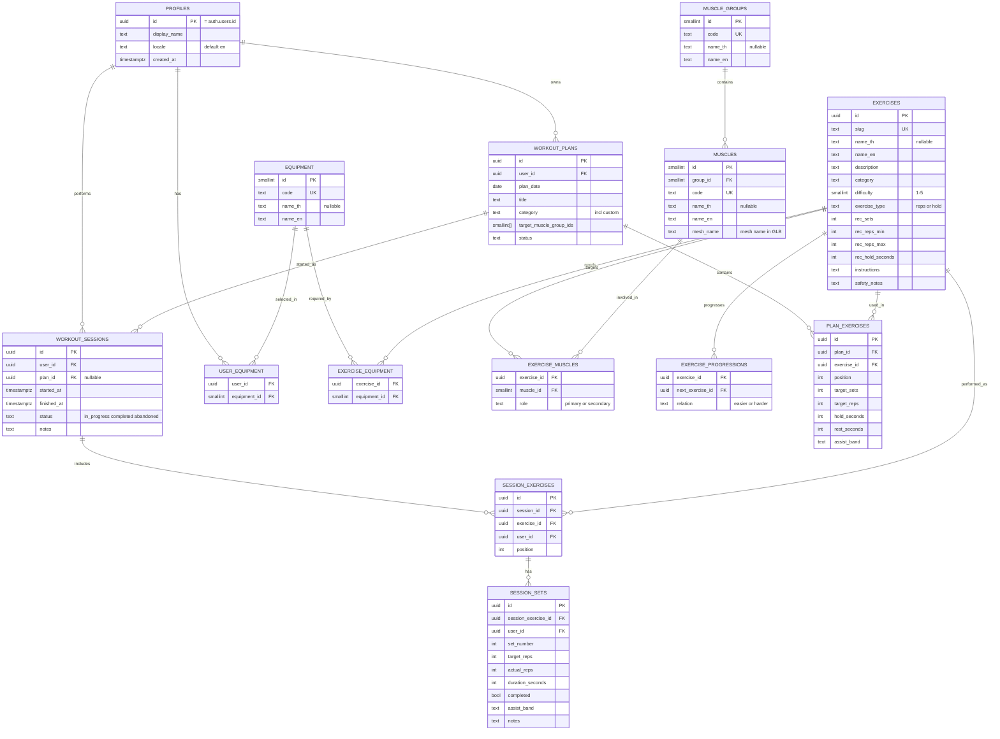

# CaliTrack 3D — Architecture, Auth & ERD

Approved plan: NAT-53 (rev 2). UI language is **English**; `name_th` columns are nullable and unused in the MVP.
The API contract is [`openapi.yaml`](./openapi.yaml) — the single source of truth for FE/BE. Contract changes go through the CTO.

## 1. System

Conventions: Handler → Service → Repository (pgx), Chi router, `userID` from context on every user-data query, one error format, FE and API on the same Vercel domain (rewrite `/api/v1/*`).

### Vercel Go Functions
- Go runs as a serverless function, not a persistent process. One function `backend/api/index.go` builds the Chi router (cached in a global) and `vercel.json` rewrites `/api/v1/(.*)` to it. Local dev: `cmd/server/main.go` serves the same router.
- DB via Supabase pooler (transaction mode, port 6543): small pgxpool, `default_query_exec_mode=simple_protocol` (no prepared statements).
- Spike S0 must validate this (incl. cold start) before the backend scaffold is built. If it fails, report to the board; do not change stack unilaterally.

## 2. Authentication

- Go verifies every JWT (ES256/RS256 via JWKS, or HS256 if the project is legacy) and uses `sub` as `user_id`.
- No service-role key in FE or Go code; Go uses a least-privilege DB role. Secrets only in Vercel env, never in git.
- Next.js middleware protects `/(app)/*`, redirecting to `/login`.
- RLS on every user-data table (`user_id = auth.uid()`) as defense-in-depth; reference tables readable by authenticated users, writable only via migrations.
- `profiles` row is created by a trigger on `auth.users`.
- Other users' resources return 404.

## 3. ERD

Notes:
- `session_*` tables are snapshots of what was actually recorded; later plan edits do not change history.
- `user_id` is denormalized onto `session_exercises` and `session_sets` for RLS, indexing and fast ownership checks.
- Personal records and analytics are computed from `session_sets` via SQL views/queries (no separate tables in the MVP).
- Indexes: `workout_plans(user_id, plan_date)`, `workout_sessions(user_id, started_at)`, `exercise_muscles(muscle_id)`, `session_exercises(exercise_id)`.
- All FKs declared; `ON DELETE CASCADE` only parent→child for user data. Every schema change is a migration in `supabase/migrations/`.

## 4. 3D ↔ data link
`muscles.mesh_name` maps to mesh names in the GLB; the viewer uses `muscle.code` as the shared key. Selecting an exercise highlights its primary (red) and secondary (orange) muscles; clicking a mesh calls `GET /exercises?muscle=<code>`.

## 5. Working rules
Feature branch + PR, CI green and CTO review before QA, one owner per folder (`frontend/ backend/ supabase/ .github/`), no direct pushes to `main`.
